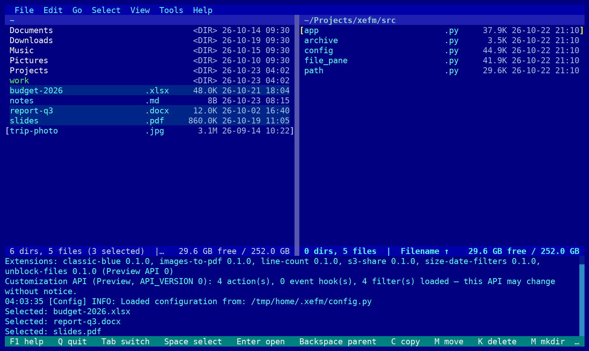

# Classic Blue

An [XeFM](https://github.com/crftwr/xefm) extension: a theme in the classic
dual-pane look — a blue background, folders in white, files in cyan, and a
yellow cursor cue.



| Element | Color |
|---|---|
| Background | blue `(0, 0, 128)` |
| Files / text | cyan `(85, 255, 255)` |
| Folders | white |
| Symlinks | green |
| Cursor cue (focused pane) | yellow |
| Status bar | teal |

Colors only — no background animation or screen effect — so it looks the same
in the terminal and in the desktop app.

## Install

Needs XeFM 1.9.0 or later. The desktop app and the terminal app share
`~/.xefm`, so either way below installs it for both.

**With the `xefm` command** (pip, pipx, uv or the Homebrew formula):

```bash
xefm ext install github:crftwr/xefm-extensions/classic-blue
```

Then **restart XeFM**. Tools ▸ Reload Configuration does not add a newly
installed theme to the list yet (crftwr/xefm#708).

**In the desktop app** (macOS, Windows), which has no `xefm` command:

1. Download
   [main.zip](https://github.com/crftwr/xefm-extensions/archive/refs/heads/main.zip).
   Once 0.1.0 is released, its tag's zip,
   [classic-blue-v0.1.0.zip](https://github.com/crftwr/xefm-extensions/archive/refs/tags/classic-blue-v0.1.0.zip),
   gives that exact version.
2. Extract it: put the cursor on the zip and choose **File ▸ Extract
   Archive…** (XeFM extracts into the other pane's folder), or use Finder /
   Explorer. The zip itself cannot be installed, because the package is in a
   subfolder.
3. Open the extracted folders until you see `classic-blue`, put the cursor on
   it and choose **Tools ▸ Advanced ▸ Install Extension…**.
4. XeFM lists what the package adds: one theme. Choose **Install** (the dialog
   starts on Cancel), then restart XeFM.

## Use

Pick **Classic Blue** in **View ▸ Theme**, or cycle to it with the
`toggle_color_scheme` action (command palette). XeFM remembers the theme across
restarts.

To adjust it, define a theme in `THEMES` in `~/.xefm/config.py` with
`'base': 'Classic Blue'` and only the colors you want to change.

## Develop

```bash
xefm ext check classic-blue
cd classic-blue && python -m pytest tests
```

The tests do not need XeFM. They check that every color is an RGB tuple and
that text on the blue meets WCAG contrast (4.5:1).

The theme is a Python dict ([`theme.py`](classic_blue/theme.py)) rather than
a table in the manifest, because colors written in TOML arrive as lists and
crash XeFM when the theme is selected (crftwr/xefm#708). `THEMES` is still
Preview (`API_VERSION` 0) and may change.
