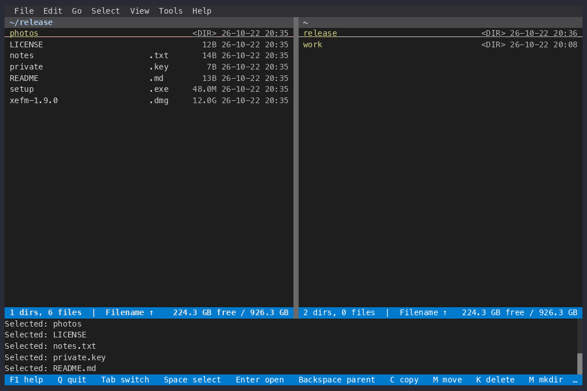

# Compute Hash

An [XeFM](https://github.com/crftwr/xefm) extension: compute the MD5, SHA-1,
SHA-256, SHA-512 or BLAKE2b digest of the selected files and show the result
in a form you can paste into `sha256sum -c`.



## Install

Needs XeFM 1.10.0 or later. On XeFM 1.9.0, install version
0.1.0 instead: add `@compute-hash-v0.1.0` to the source below, or download
[compute-hash-v0.1.0.zip](https://github.com/crftwr/xefm-extensions/archive/refs/tags/compute-hash-v0.1.0.zip)
in the desktop app's step 1. The desktop app and the terminal app share
`~/.xefm`, so either way below installs it for both.

**With the `xefm` command** (pip, pipx, uv or the Homebrew formula):

```bash
xefm ext install github:crftwr/xefm-extensions/compute-hash
```

Then run **Tools ▸ Reload Configuration** in XeFM, or restart it.

**In the desktop app** (macOS, Windows), which has no `xefm` command:

1. Download
   [main.zip](https://github.com/crftwr/xefm-extensions/archive/refs/heads/main.zip).
   A release's tag zip, such as
   [compute-hash-v0.2.0.zip](https://github.com/crftwr/xefm-extensions/archive/refs/tags/compute-hash-v0.2.0.zip),
   gives that exact version.
2. Extract it: put the cursor on the zip and choose **File ▸ Extract
   Archive…** (XeFM extracts into the other pane's folder), or use Finder /
   Explorer. The zip itself cannot be installed, because the package is in a
   subfolder.
3. Open the extracted folders until you see `compute-hash`, put the cursor on
   it and choose **Tools ▸ Advanced ▸ Install Extension…**.
4. XeFM lists what the package adds: the `hash.compute` action and its menu
   items. Choose **Install** (the dialog starts on Cancel). XeFM reloads its
   configuration, and **File ▸ Compute Hash…** appears.

It uses `ctx.run_task` with `job.item_progress`, `ctx.show_markdown`,
`extension(__name__)` and `[contributes.menus]`, which are new in 1.9.0.

## Use

**File ▸ Compute Hash…**, the row's context menu, or the command palette
(`hash.compute`).

1. Pick the algorithm. The last one used is listed first, so `Enter` repeats
   it.
2. The selected files are hashed — or the file under the cursor when nothing
   is selected. Directories are skipped. Files on `ssh://`, `s3://` and inside
   archives are read through XeFM, the same as local ones.
3. Hashing runs as a task: a progress dialog with Cancel and *Run in
   background*, and a byte bar for the file being read. It is read-only, so
   it does not wait behind a background copy.
4. The result shows one line per file, in selection order:

   ```
   9f86d081884c7d659a2feaa0c55ad015a3bf4f1b2b0b822cd15d6c15b0f00a08  setup.exe
   e3b0c44298fc1c149afbf4c8996fb92427ae41e4649b934ca495991b7852b855  notes.txt
   ```

   The block's **Copy** button copies every line; select text to copy one.
   Files that could not be read are listed below the block with the reason,
   so what you copy stays valid input for `sha256sum -c` (or `md5sum -c`,
   `b2sum -c`, …).

There is no default key. To bind one, add it to `KEY_BINDINGS` in
`~/.xefm/config.py`:

```python
KEY_BINDINGS = {
    'hash.compute': ['Ctrl-Shift-H'],
}
```

## Develop

```bash
xefm ext check compute-hash
cd compute-hash && python -m pytest tests
```

`tests/test_actions.py` needs XeFM importable; `tests/test_logic.py` does not.

This package uses only XeFM's public API (`xefm.user_api.__all__`), much of
which is still Preview (`API_VERSION` 0) and may change.
