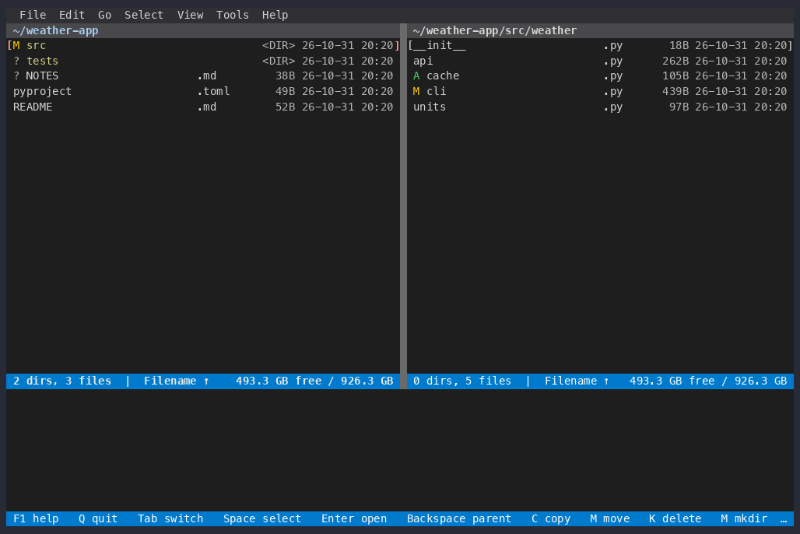

# Git

An [XeFM](https://github.com/crftwr/xefm) extension for Git. It shows each
file's status before its name, lists a repository's changed files as one
list, opens any revision as a read-only folder, and compares a file with its
older versions in XeFM's own diff viewer.



It only reads the repository. Adding, committing and switching branches stay
in a real Git tool, which **Open Git Tool** starts for you.

## Install

Needs XeFM 1.12.0 or later and `git` on your PATH. The desktop app and the
terminal app share `~/.xefm`, so either way below installs it for both.

**Inside XeFM** (desktop app or terminal): choose **Tools ▸ Advanced ▸ Install
Extension…** and paste

```text
github:crftwr/xefm-extensions/git
```

XeFM downloads and checks the package and lists what it adds: the
`git.status` attribute, the **Git status** extra, the `git://` folders and
five actions. Choose **Install** (the dialog starts on Cancel); XeFM reloads
its configuration.

**With the `xefm` command** (pip, pipx, uv or the Homebrew formula):

```bash
xefm ext install github:crftwr/xefm-extensions/git
```

Then run **Tools ▸ Reload Configuration** in XeFM, or restart it.

## Use

### Status in the file list

In a folder inside a Git working tree, a letter before a name says what has
changed:

| Letter | Status |
|---|---|
| `M` | Modified (whether or not the change is added) |
| `A` | Added |
| `D` | Deleted |
| `R` | Renamed |
| `U` | Conflicted |
| `?` | Untracked |

A folder shows the most important letter of the changes inside it, in the
order of the table. Turn the letters on or off for a tab under **View ▸ Show ▸
Git status**. The sort dialog offers **Git status** while they show, and the
attribute `git.status` can go in a layout of your own, as a word:

```python
LAYOUTS = {
    'git': {'label': 'Git', 'columns': [
        'name', 'ext', {'attr': 'git.status', 'format': 'word'}, 'size']},
}
```

The status is read again when the folder's listing changes. A commit made
outside XeFM changes no file in the folder, so refresh the pane to see it
(**Open Git Tool** refreshes for you when the tool exits).

### Actions

Every action is in the command palette (type `git`). The ones on a file are
also in the context menu, and all five are in the **File** menu.

| Action | Menu | What it does |
|---|---|---|
| `git.changed` | Git: Changed Files | Every changed and untracked file of the repository, as one list in the pane. Backspace goes back. |
| `git.diff_head` | Git: Compare with HEAD | The file under the cursor beside its HEAD version, in the diff viewer. In a revision folder, that revision's file beside the working tree's. |
| `git.log` | Git: File History… | The commits that changed the file, following renames. Pick one to compare it with the working file or with the version before it, or to open its folder. |
| `git.browse` | Git: Browse Revision… | HEAD, a branch, a tag or a recent commit, opened as a read-only folder at the folder you are in. |
| `git.open_tool` | Git: Open Git Tool | Starts your Git tool in the repository: lazygit unless you choose another. |

There are no default keys. To bind one, add it to `KEY_BINDINGS` in
`~/.xefm/config.py`:

```python
KEY_BINDINGS = {
    'git.diff_head': ['Alt-D'],
}
```

### Revisions as folders

A revision opens as a folder whose path is the repository, then git's own
`<revision>:<path>`:

```text
git://~/projects/weather-app#v0.1.0:src/weather
```

You can type such a path in **Jump to Path** or keep it in your favorites.
Files in it open in the viewer and can be copied out. Copying an old version
into the working tree is how you restore it. A name like `HEAD` or a branch
follows the branch as it moves; a commit id stays put.

### Settings

Put a `GitConfig` class in your `config.py` with the settings you change
(`xefm ext settings git` prints all of them):

```python
class GitConfig:
    TOOL = "tig"                      # or ["gitui"], ["open", "-a", "Fork", "."]
    TOOL_TERMINAL = True              # False for a desktop client
    LOG_LIMIT = 200                   # commits File History lists
```

## Limits

- Local working trees only. On SSH, S3 or in an archive, there are no letters
  and the actions say so.
- In a very large repository, `git status` may take a while. The letters
  arrive when it answers; after ten seconds they are left out.
- A submodule shows as one folder with its own status; nested repositories
  are not looked into.
- A repository whose path has a `#` in it cannot be opened as a revision
  folder.

## Develop

```bash
xefm ext check git
cd git && python -m pytest tests
```

The tests need `git`; most also need XeFM importable. They build a scratch
repository for each test.

This package uses only XeFM's public API (`xefm.user_api`, `xefm.path_base`).
