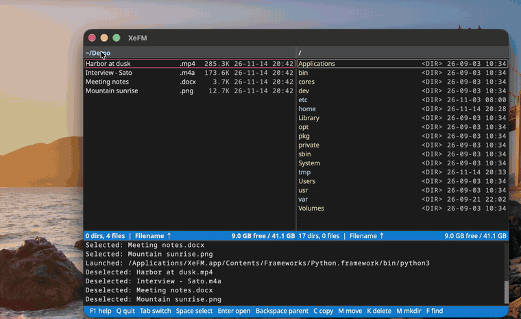

# OS Preview

An [XeFM](https://github.com/crftwr/xefm) extension: show the selected files in
the operating system's own preview. On macOS that is **Quick Look**, the panel
Finder opens with the Space bar. It plays audio and video and shows Office
documents, fonts and anything else macOS has a preview for, so it covers what
XeFM's own viewers do not.



macOS only for now. Windows has no built-in preview of this kind, and support
for the third-party ones (QuickLook, PowerToys Peek) is planned
([crftwr/xefm discussion #891](https://github.com/crftwr/xefm/discussions/891)).

## Install

Needs XeFM 1.10.0 or later, on macOS. On Windows and Linux XeFM skips the
package ("not made for …").

**Inside XeFM** (desktop app or terminal): choose **Tools ▸ Advanced ▸ Install
Extension…** and paste

```text
github:crftwr/xefm-extensions/os-preview
```

XeFM downloads and checks the package and lists what it adds: the
`preview.show` action, its menu items and its key. Choose **Install** (the
dialog starts on Cancel); XeFM reloads its configuration, and **File ▸ Quick
Look** appears.

**With the `xefm` command** (pip, pipx, uv or the Homebrew formula):

```bash
xefm ext install github:crftwr/xefm-extensions/os-preview
```

Then run **Tools ▸ Reload Configuration** in XeFM, or restart it.

## Use

Put the cursor on a file, or select several, and press `Shift-Q`. You can also
choose **File ▸ Quick Look**, use the row's context menu, or run
`preview.show` from the command palette.

- With several files, the left and right arrow keys step through them, as in
  Finder. The panel's grid button shows them all at once.
- `Space` or `Esc` closes the panel, and XeFM has the keyboard again: the
  desktop app, or the terminal XeFM runs in.
- Switching to another app also closes it.
- Only files on the local disk can be shown. Files inside archives or on
  SSH / S3 are left out, and XeFM says how many.

`Shift-Q` is free in every keymap preset. If you have already bound it to
something else, the suggestion is not applied; bind the action yourself in
`~/.xefm/config.py`:

```python
KEY_BINDINGS = {
    'preview.show': ['Shift-Q'],
}
```

### The first audio file in the terminal app

The first time Quick Look plays an audio file for the terminal app, macOS asks
whether *Terminal* (or iTerm2, …) may use the microphone. Quick Look asks
this, not XeFM. Finder's own Quick Look does not, and running `qlmanage -p`
from a terminal asks the same thing. Playback does not need the microphone:
choose **Don't Allow**, and press `Shift-Q` again, because answering the
question closes the panel. macOS remembers the answer. The desktop app is not
asked.

## How it works

The panel is shown by a small helper process, run by XeFM's own Python. It
opens Quick Look's panel in front, remembers which app was in front before
(XeFM's window, or the terminal XeFM runs in), and when the panel closes gives
the keyboard back to exactly that app. It has no Dock icon and no menu bar.

It does not use `qlmanage -p`. That is a debug tool: its panel can open behind
XeFM's window, its title says `[DEBUG]`, and when it closes macOS decides
which app comes forward. The helper falls back to `qlmanage` only where PyObjC
cannot be imported, which does not happen in an XeFM installed the usual ways.

## Develop

```bash
xefm ext check os-preview
cd os-preview && python -m pytest tests
```

The tests run on any system and start nothing: they check which files are
handed to the helper, and with which `PYTHONPATH`. `tests/test_actions.py`
needs XeFM importable. The panel itself needs a desktop session. It was tried
by hand in a macOS VM, from the terminal app and from the desktop app.

This package uses only XeFM's public API (`xefm.user_api.__all__`).
